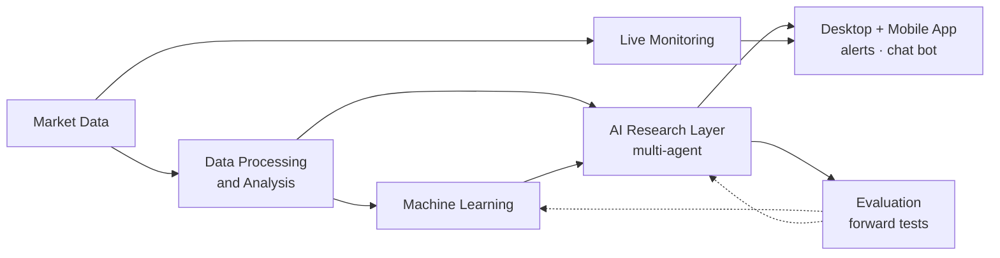

# KAIRO

**A multi-agent AI system that researches the stock market every day and monitors it live.**

`Python` `Claude multi-agent` `PyTorch` `scikit-learn` `LightGBM` `SQLite` `WebSockets` `JavaScript / WebGL`

<!-- Add a 60-90 second demo GIF or video here (tickers blurred) -->

## What is KAIRO?

KAIRO is my personal **AI research assistant for swing trading** (buying stocks and holding them for days to weeks).
Swing traders spend hours every night going through hundreds of charts and news stories, looking for the few stocks
worth watching tomorrow. KAIRO does that work for me.

It works like a small research team that never gets tired:

- **Every evening,** AI agents go through the market the way an experienced trader would: they look at the charts
  (as images, not just numbers), read the news behind each move, and check everything against a written rulebook.
  The result is a short watchlist where every stock comes with a plain-English explanation: why it's interesting,
  what would confirm it, and what could go wrong.
- **During the trading day,** a monitoring service watches those stocks live and sends an alert to my phone within
  seconds when one of them does something I need to know about.
- **Over time,** everything it says is recorded before the outcome is known and scored afterwards, so I can see what
  actually works instead of trusting how confident it sounds.

I use it through my own desktop and phone app and a private chat bot. **It never places trades.** It finds, explains
and watches, and I make every decision.

## What it does, in short

- 🔎 **Researches** thousands of US stocks every day and turns them into a short, explained watchlist
- ⚡ **Monitors** live market data all day and alerts my phone within seconds
- 📊 **Measures itself**: every output is logged before the outcome is known, then scored

## How it fits together

## Engineering highlights

| Area | What I built |
|---|---|
| **Multi-agent AI** | A daily pipeline of coordinated AI agents that runs without supervision. Every step leaves an auditable record, failures are retried, and every conclusion carries its reason. |
| **Machine learning** | Models trained on 10+ years of market data with walk-forward testing, locked holdout sets and leakage checks, plus computer-vision models on chart images. |
| **Labeled data** | A pipeline that turns unstructured expert commentary into verified training labels, with independent AI passes and automatic validators. |
| **Real-time systems** | A live service that merges market-data streams, checks conditions on every price update, and alerts within seconds, with de-duplication and a health watchdog. |
| **Full-stack app** | A self-hosted desktop and phone web app: private network, PIN access, push notifications, live agent views, WebGL. |
| **Cost control** | A large daily AI workload kept inside fixed usage limits, with monitoring, automatic pausing and hard spending caps. |

## The most important lesson

The project began as **Kairos**, a machine-learning model that ranked chart setups. Its test scores looked strong,
but when I checked *why*, most of its skill came from a simple market effect rather than real pattern recognition. I
documented it, retired the model as the decision-maker, and rebuilt the project as **KAIRO**, where AI agents do the
research, ML is one input, and everything is evaluated going forward.

> Research project, in daily use. **Not proven profitable**, not a trading system. I make my own decisions.

**More:** [System overview](docs/system-overview.md) · [Full details](docs/details.md)

---
Trading rules, prompts, models and data are private. Not financial advice. © 2026 Rafael Fonyat. All rights reserved.
