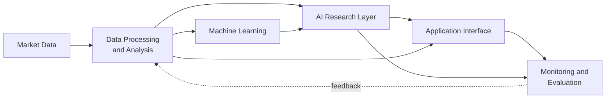

# KAIRO: the details

[← Back to the overview](../README.md)

## Project Overview

KAIRO is a personal AI system I built to support my own swing-trading research. It does three things:

- **Researches the market every day.** It narrows a universe of thousands of US stocks to a short, explained
  watchlist, combining data analysis, chart vision and news research by AI agents, and a written rule base.
- **Watches the market live.** During the trading day, a monitoring service streams prices and sends alerts to my
  phone within seconds when something on the watchlist needs attention.
- **Measures itself.** Every output is logged before the outcome is known and evaluated afterwards, so the system's
  usefulness is measured rather than assumed.

I make every trading decision myself. KAIRO finds, explains and watches; it cannot place trades.

### From Kairos to KAIRO

The project started as **Kairos**, a machine-learning research project: a model trained to recognize promising chart
setups from historical data and expert-labeled examples. Rigorous evaluation showed that much of the model's apparent
skill came from a simple market property rather than genuine pattern recognition. I documented that result, retired
the model as the decision-maker, and rebuilt the project as **KAIRO**: a broader system in which multi-agent AI does
the research, machine learning supports it as one input among several, and every component is continuously evaluated.
The name comes from *kairos*, Greek for *the right moment*.

---

## Why I Built It

Swing trading rewards seeing the right opportunity at the right moment, but a person can review only a limited number
of charts and news stories each day, and judgment drifts with fatigue. Experienced traders recognize good setups
quickly, yet that judgment is hard to write down and harder to apply consistently.

I wanted to find out how far modern AI could go in applying that kind of judgment consistently and transparently, and
to build it the way production software is built: monitored, tested, cost-controlled and honest about what it cannot
do.

---

## High-Level System Overview

| Layer | Purpose |
|---|---|
| **Market Data** | Historical and live market data, news and company information from several sources |
| **Data Processing and Analysis** | Cleaning, validation and analysis of large historical and daily datasets |
| **Machine Learning** | Research models built and evaluated with time-aware testing |
| **AI Research Layer** | Multi-agent AI that reviews charts, researches news and explains its conclusions |
| **Application Interface** | A self-hosted desktop and mobile web app, notifications and a private chat bot |
| **Monitoring and Evaluation** | Real-time monitoring, system health checks and outcome tracking |

More detail: [system-overview.md](system-overview.md).

---

## Technology Stack

Only technologies that are actually used in the project.

| Category | Technologies |
|---|---|
| **Languages** | Python · JavaScript · HTML / CSS |
| **Data and analysis** | pandas · NumPy · SciPy · Matplotlib |
| **Machine learning** | scikit-learn (gradient boosting) · LightGBM · PyTorch / torchvision (computer vision) · OpenCV · Pillow |
| **AI / LLMs** | Claude (multi-agent orchestration, vision, the Anthropic Python SDK) · OpenAI GPT models (news research) · Google Gemini (multimodal understanding) |
| **Data storage** | SQLite · columnar files (Parquet) · CSV / JSON logs |
| **Real-time** | WebSocket market-data streams · multi-threaded Python services |
| **Web and app** | A self-hosted Python web server · a plain-JavaScript single-page app · WebGL · an installable progressive web app (web push notifications) · a Discord bot (discord.py) |
| **Infrastructure** | Git / GitHub (private) · Tailscale (private networking) · Windows scheduled tasks · Notion API (reporting) |

---

## Engineering Challenges

### Building multi-agent AI applications
Coordinating several AI agents so that a long, multi-step research process finishes reliably every day without
supervision. Each step produces an inspectable record, failures are retried, work is split across agents when the
load grows, and conclusions must be traceable to an explicit written reason, so a wrong conclusion can be corrected
at its source.

### Processing large financial datasets
Maintaining more than a decade of daily data for thousands of stocks, refreshed every day, with automated cross-checks
between independent sources and documented handling of known biases such as survivorship bias.

### Developing machine-learning pipelines
Building feature pipelines and models with strictly time-aware evaluation (walk-forward testing and locked holdout
periods), so that no model is ever evaluated on information it could not have had at the time.

### Working with expert-labeled visual information
Turning unstructured expert commentary into structured, verifiable training labels. Multimodal AI does the
extraction, and independent passes with automatic validators check every label before it is used. Locked test sets
are kept aside for honest evaluation.

### Building real-time monitoring infrastructure
A long-running service that merges live market-data streams, evaluates conditions on every price update, and delivers
alerts within seconds, with de-duplication, data-quality logging, and a watchdog that alerts me when a data feed, a
scheduled job or the notification channel itself stops working.

### Designing model evaluation and forward testing
Pre-registered tests with pass / fail criteria fixed in advance, confidence intervals instead of single numbers, and
append-only forward ledgers in which each day's outputs are recorded before the outcome is known.

### Managing computational and AI usage constraints
Running a large daily AI workload inside fixed subscription and budget limits: usage monitoring, automatic pausing
before limits are reached, hard spending caps, and a design where most of the workload is plain code that costs
nothing to run.

### Developing a self-hosted web application
A desktop and mobile web app served from my own machine over a private network, with PIN-protected device access,
push notifications, live views of the AI agents at work, and an interactive WebGL landing page, without depending on
a hosted cloud backend.

---

## Machine Learning and Research Philosophy

- **Measure before believing.** Every hypothesis gets a written test before it runs.
- **Time is sacred.** Models are trained only on the past and tested only on the future.
- **Know why it works.** A good score is not enough; I check what is actually driving a model's results. That check is
  what retired the original Kairos model.
- **Keep negative results.** Failed experiments are documented and inform what gets built next.
- **Show uncertainty.** Where a signal has no proven skill, the system says so instead of displaying a confident number.
- **Humans decide.** The system explains and informs; it never acts on its own.

---

## Development Status

| Component | Status |
|---|---|
| Daily AI research pipeline | In daily use |
| Real-time market monitoring and alerts | In daily use |
| Desktop and mobile web app | In daily use |
| Outcome tracking and forward testing | Collecting data |
| Machine-learning research | Ongoing; the original model is retired as a decision-maker |

> **KAIRO has not been shown to be profitable.** It is a research and engineering project, not a trading system or
> an investment product.

---

## Intellectual Property and What Is Not Public

This repository is **documentation only**. The working system is in a private repository.

Not published, on purpose:

- trading strategies, screening logic, rules, thresholds and indicators;
- the AI agents' prompts, roles and coordination logic;
- model files, features, training data and training procedures;
- the internal architecture, data pipelines, database schemas and data-provider configuration;
- ranking and grading methods, research results and trading history;
- other people's content used for research (their videos, charts and words remain theirs);
- keys, credentials, configuration or anything needed to run the system.

Screenshots in [screenshots](screenshots) have tickers, prices and account details removed.

---

## Disclaimer and Copyright

*Nothing in this repository is financial advice. KAIRO is a personal research project, and I make my own trading
decisions.*

© 2026 Rafael Fonyat. All rights reserved. No license is granted to copy, modify or distribute this material.
