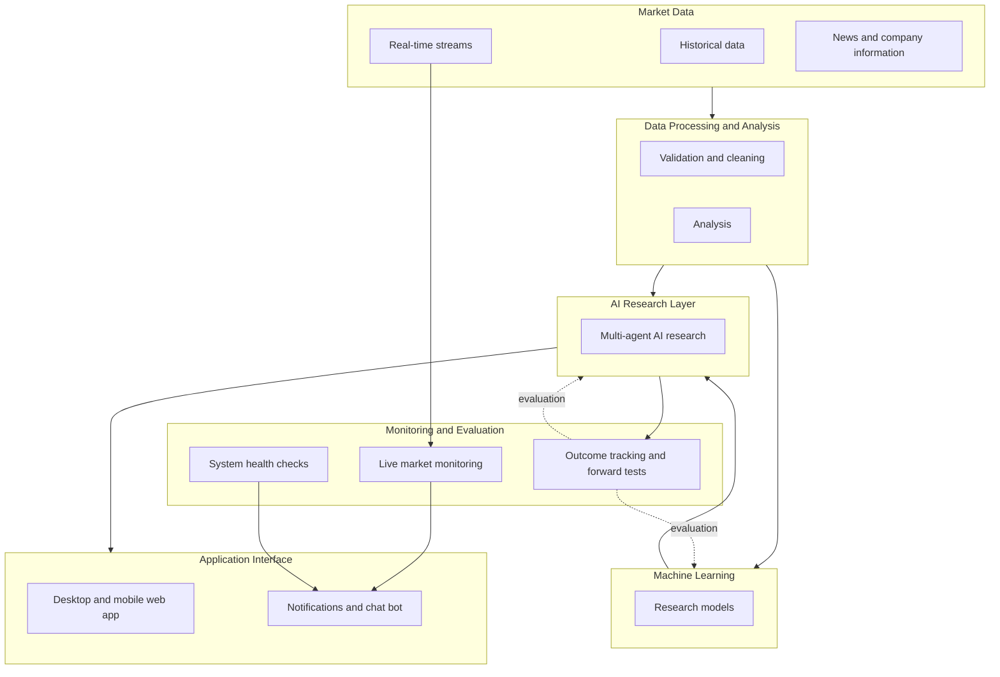

# KAIRO: System Overview

A simplified, high-level view of how KAIRO is organized. It shows the engineering layers and how they relate; it is
**not** a description of the internal architecture, and it leaves out on purpose the components, their order, the
methods and the rules inside each layer.

## The layers

### Market Data
Historical and live market data, news and company information from several independent sources, so that important
values can be cross-checked rather than trusted from a single feed.

### Data Processing and Analysis
Turns raw data into clean, validated datasets: more than a decade of daily history for thousands of stocks, refreshed
every day, with automated quality checks and documented known biases.

### Machine Learning
Research models trained and evaluated with strictly time-aware methods (walk-forward testing, locked holdout periods,
leakage checks). Models inform the research; they do not make decisions.

### AI Research Layer
A multi-agent AI layer that combines chart vision, news research and a written rule base to produce an explained
watchlist. Its work runs on a schedule, leaves a complete inspectable record, and every conclusion carries the reason
behind it.

### Application Interface
A self-hosted web application for desktop and mobile (installable, over a private network, PIN-protected), with push
notifications, live views of the system at work, and a private chat bot.

### Monitoring and Evaluation
- **Live monitoring:** a long-running service that evaluates real-time market data continuously and alerts within
  seconds.
- **System health:** a watchdog that reports missed scheduled jobs, silent data feeds, high AI usage and notification
  failures.
- **Evaluation:** append-only logs of every output, recorded before outcomes are known and scored afterwards, feed back
  into how the models and the research layer are judged.

## Design principles

- **Humans decide.** The system has no ability to trade.
- **Inspectable by default.** Every step leaves a record that can be audited later.
- **Cost-aware.** Most of the workload is plain code; AI usage runs inside fixed limits with automatic pausing.
- **Private by default.** Self-hosted, private networking, credentials kept local.
